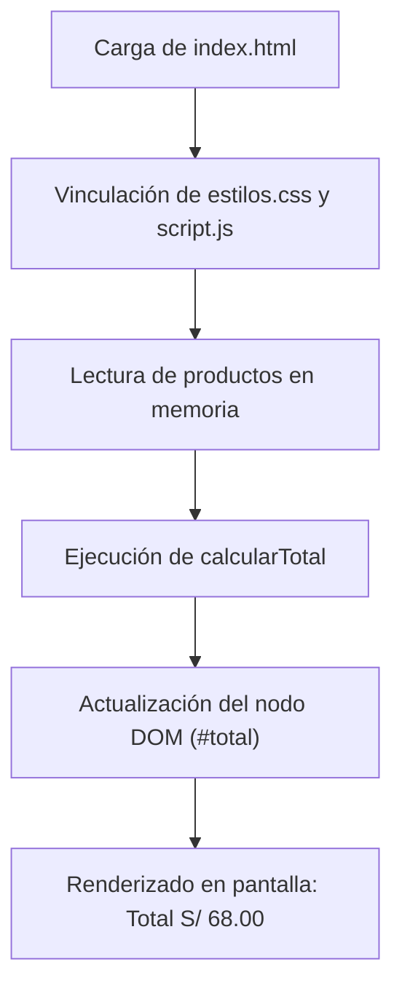

# Tienda TECSUP


 


Tienda TECSUP es una aplicación web interactiva de catálogo y punto de venta institucional desarrollada para el curso de Diseño de Interfaces de Programación Avanzado. Permite listar artículos académicos en tiempo real, calcular automáticamente subtotales y totales en el cliente, y servir como base modular y didáctica para la integración de interfaces frontend reactivas.

---

## Tabla de Contenidos

- [Descripción](#descripción)
- [Arquitectura](#arquitectura)
- [Instalación](#instalación)
- [Uso](#uso)
- [Catálogo de Productos](#catálogo-de-productos)
- [Hoja de Ruta](#hoja-de-ruta)
- [Contribución](#contribución)

---

## Descripción

El proyecto implementa la lógica de interfaz de un carrito de compras escolar y universitario. A través de HTML5 semántico, reglas CSS3 institucionales y funciones nativas en JavaScript, realiza la sumatoria reactiva de productos adquiridos sin necesidad de librerías externas.

---

## Arquitectura

El siguiente diagrama representa el flujo principal de carga y procesamiento de la aplicación:


    ---

## Instalación

Para clonar y poner en marcha el proyecto localmente, ejecuta en tu terminal:

```bash
git clone https://github.com/danypinedo-cpu/tienda-tecsup.git
cd tienda-tecsup
python3 -m http.server 8000

```
---

## Uso

Para añadir nuevos elementos o alterar la lista de compras, modifica la estructura de datos en `script.js`:

```javascript
const productos = [
  { nombre: "Polo TECSUP", precio: 25.00, cantidad: 2 },
  { nombre: "Taza TECSUP", precio: 18.00, cantidad: 1 }
];
function calcularTotal(lista) {
  return lista.reduce((acumulador, item) => acumulador + (item.precio * item.cantidad), 0);
}
document.getElementById("total").innerText = `Total: S/ ${calcularTotal(productos).toFixed(2)}`;

---
```
## Catálogo de Productos

| Artículo | Categoría | Precio Unitario | Cantidad | Subtotal |
| :--- | :---: | ---: | :---: | ---: |
| Polo TECSUP | Indumentaria | S/ 25.00 | 2 | S/ 50.00 |
| Taza TECSUP | Accesorios | S/ 18.00 | 1 | S/ 18.00 |
| **Total** | **General** | **—** | **3** | **S/ 68.00** |

---

## Hoja de Ruta

- [x] Estructuración semántica de tabla de artículos (`index.html`).
- [x] Integración de estilos institucionales (`estilos.css`).
- [x] Cálculo dinámico de totales (`script.js`).
- [ ] Formulario para agregar productos desde la página.
- [ ] Persistencia de compras mediante `localStorage`.

---

## Contribución

Lee la [guia de contribucion](CONTRIBUTING.md) antes de enviar cambios.